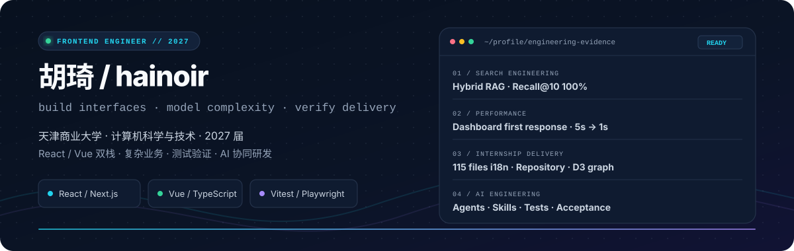

# 胡琦 / hainoir

  

  <strong>2027 届 · 前端开发 · React / Vue / TypeScript</strong>

  <a href="https://hainoir.github.io"><strong>个人博客</strong></a> ·
  <a href="https://github.com/hainoir"><strong>GitHub</strong></a> ·
  <a href="mailto:hainoir700@gmail.com"><strong>Email</strong></a>

---

## 关于我

天津商业大学计算机科学与技术专业本科在读，2027 届。目前专注于现代 Web 应用开发，拥有 React / Next.js 与 Vue 3 双技术栈实践，关注复杂业务状态、前后端契约、数据一致性、自动化测试与性能优化。

实习和个人项目中，我既处理过大型存量前端项目中的需求迭代、线上缺陷与国际化改造，也独立完成过校园 RAG、社团运营平台和职业院校专业群管理平台。习惯从需求边界和数据流出发拆解问题，通过类型、测试、Diff 审查和真实页面验收控制交付质量。

我长期使用 AI 辅助软件工程，但更关注它进入真实研发流程后的可靠性：如何约束修改范围、验证生成结果、保留交付证据，以及把重复经验沉淀为可复用的规则与 Skill。

---

## 实习经历

### 超星智慧教育科技有限公司 · 前端研发工程师

`2026.07 - 至今` · Vue 3 / TypeScript / Pinia / D3.js / Vue I18n

#### 许昌职业技术学院专业群建设管理系统｜前端独立开发

面向职业院校专业群建设场景，围绕“产业—岗位—专业—能力—课程”全链路完成前端建设，重点解决双角色协作、上下游数据依赖、关系数据可视化，以及公司向 FDE 研发模式转型过程中接口契约持续变化的问题。

- **AI 快速开发与 FDE 转型适配**：在工期紧、原型与工程化并行、接口契约持续调整的条件下，采用 Repository 模式隔离业务页面与数据源；封装统一 HTTP Client 处理鉴权、超时、请求取消和错误分类，实现 Mock / HTTP 无侵入切换，使前端能够独立开发、稳定演示并平滑接入真实接口。
- **多层关系图谱建设**：针对产业、岗位、专业、能力点与课程关系层级多、表格难以直观呈现的问题，基于 D3.js 与 BFS 算法实现多层自适应图谱，支持缩放、节点筛选、连通路径高亮和直接 / 间接课程区分，使用户能够从产业链追溯至课程并识别完整关联路径。
- **AI 异步任务接入**：针对培养方案生成耗时长、同步请求易超时及页面切换产生竞态的问题，基于 `setTimeout + AbortController` 封装排队、生成中、成功、失败和超时状态机，通过定时轮询、任务版本号与统一资源清理避免重复任务、过期响应覆盖及内存泄漏，实现章节级进度、失败重试和 AI Word 文档预览下载。

#### 低代码表单与审批平台｜前端开发

持续参与覆盖表单、审批、公文和问卷等产品形态的大型低代码系统迭代，负责国际化、管理页设计、审批配置、字段状态兼容及存量缺陷治理。

- **管理页国际化与设计验收 Skill**：针对动态句式复杂、系统文案与用户数据混合、英文文本易破坏原有布局等问题，新增 **11 个业务词库模块、15 个翻译作用域**，完成筛选项、按钮、字段、统计和预览模板等 **115 个代码文件**的中英文适配；沉淀设计验收 Skill，使用多模态 AI 辅助核对翻译挂载、长文本布局和多语言页面一致性。
- **业务迭代与兼容性维护**：累计完成 **10+ 项**业务需求与缺陷处理，涉及筛选项、审批配置等 **6 类模块**；重点处理表单字段、系统字段、派生字段和历史配置之间的兼容关系，确保新增功能不影响旧数据回显及保存行为。
- **系统性缺陷定位**：从 132 处弹窗调用中定位“组件脱离应用实例渲染导致作用域词表失效”的翻译链问题，梳理受损范围、方案边界和回归清单，使用领域隔离方案修复而不污染创建页与审批页。
- **工程交付协作**：遵循功能分支、代码审批、测试环境、灰度环境和 Jenkins 发布流程，能够处理并行分支、未提交变更保护、合并冲突、回归验证与交付状态同步。

---

## 项目经历

### [校园智能问答 RAG 平台](https://github.com/hainoir/rag)

`2026.01 - 2026.04` · Next.js / React / TypeScript / PostgreSQL / pgvector

面向校园公开信息查询场景，独立实现一个检索优先、答案可追溯的 explainable RAG MVP，重点解决普通聊天式产品中答案来源不可见、错误边界不清晰以及前端与检索实现耦合的问题。

- **稳定搜索契约**：前端统一请求 `/api/search`，由服务层代理独立检索服务，并通过统一 `SearchResponse` 返回状态、答案、来源和相关问题，隔离页面与底层检索实现。
- **混合检索链路**：基于 `pg_trgm + pgvector` 实现关键词与向量混合检索，支持来源权重、时效排序、拒答门控、可选 rerank 与证据约束回答。
- **可解释交互**：完成两阶段加载、答案 / 检索视图切换、来源卡片展开、相关问题与本地搜索历史，让用户能够追溯答案依据。
- **质量评测**：建立 54 条黄金查询评测集，混合检索达到 **Recall@10 100%、MRR 98.96%、nDCG@10 99.23%**。

---

### [高校学生社团管理平台](https://github.com/hainoir/club-platform)

`2025.11 - 2026.03` · Next.js / React / TypeScript / Supabase / Zustand

围绕校园社团真实运营流程开发，覆盖登录认证、成员管理、排班签到、请假代班和钥匙交接等核心场景。

- **登录态一致性**：串联 Supabase SSR 中间件、服务端用户解析、客户端 Provider、路由守卫和 Zustand Store，处理刷新、跨标签页与 Token 续期后的状态同步。
- **首屏性能优化**：抽象服务端 `dashboard-service`，并发聚合排班、请假、签到、成员和当前用户 5 类数据，将首屏响应时间由约 **5 秒降低至 1 秒**。
- **复杂业务拆分**：将值班大厅中的签到、请假、代班与钥匙交接拆分为 10+ Hooks 和工具函数，并通过统一 Hook 对外暴露状态与操作。
- **规则与测试**：对齐前端交互与数据库契约，覆盖定位签到、重复签到保护、请假代班关联和会话过期清理，并使用单元测试与 Playwright E2E 验证关键路径。

---

## 技术能力

| 方向             | 技术与实践                                            |
| :--------------- | :---------------------------------------------------- |
| **语言与基础**   | JavaScript (ES6+)、TypeScript、HTML5、CSS3            |
| **前端框架**     | React、Next.js、Vue 2 / Vue 3、Pinia、Zustand         |
| **样式与可视化** | Tailwind CSS、UnoCSS、Element Plus、D3.js             |
| **服务与数据**   | Node.js、PostgreSQL、Supabase、pgvector、REST API     |
| **质量保障**     | Vitest、Vue Test Utils、Playwright、Zod、契约测试     |
| **工程与交付**   | Git、GitFlow、Vite、Turborepo、GitLab、Jenkins        |
| **AI 协同研发**  | Codex、需求拆解、代码审查、测试验证、Skill 工作流沉淀 |

---

## 教育与经历

### 天津商业大学 · 计算机科学与技术

`2023.09 - 2027.06`

- 河北省大学生程序设计竞赛铜奖
- 蓝桥杯程序设计大赛 Java 组省级二等奖
- 团体程序设计天梯赛团队省级三等奖
- 字节跳动豆包 MarsCode 技术训练营结营（前端方向）
- 携程集团第五期前端训练营结营
- CET-4：477

### 校园技术实践

- 参与设计与维护天津商业大学官网、天津商业大学党委宣传部官网。
- 任天津商业大学融媒体技术中心开发部长，为部员讲授 HTML、CSS、JavaScript 等前端基础内容。
- 曾任天津商业大学吧吧主，参与校园垂类社区运营与活动承办。

---

## 最近在做

- 使用 Astro 重构个人博客的内容与视觉系统
- 补全 Node.js、数据库设计与服务端工程能力
- 研究 Agent / RAG，以及 AI 参与真实研发流程时的质量边界
- 继续整理实习项目中的问题定位、验收与工程协作经验

## 联系方式

- Blog：[hainoir.github.io](https://hainoir.github.io)
- GitHub：[github.com/hainoir](https://github.com/hainoir)
- Email：[hainoir700@gmail.com](mailto:hainoir700@gmail.com)
